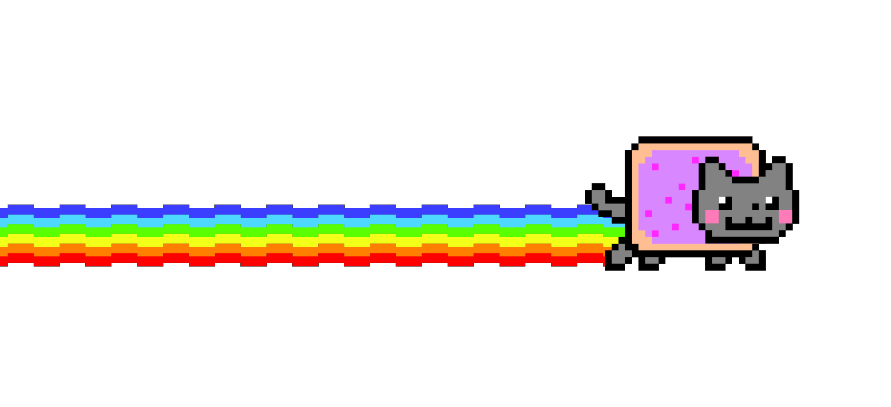

  

   

  

    

  

   

  

<!-- ABOUT ME -->

  

<h2 align="center">✦ a little about me ✦</h2>

  <i>somewhere between code, creativity and the internet.</i>

  hi! i'm isabela, a brazilian student at IFC,
  studying internet systems development.
    
  i'm curious about how things work behind the screen
  and how a simple idea can turn into something interactive.
    
  i like exploring web development, learning through projects
  and adding a little creativity to everything i build.

  currently figuring things out, one line of code at a time.

 

<!-- INTERESTS -->

<h2 align="center">✦ things i enjoy ✦</h2>

  
  

  
  

 

<!-- LEARNING -->

<h2 align="center">✦ currently learning ✦</h2>

  

  javascript · html · css

 

<!-- PROJECTS -->

<h2 align="center">✦ little things i've built ✦</h2>

  

  a collaborative school project about physical and mental well-being.
    
  i contributed to organizing the content and its visual
  and informational structure, including the exercise page.
    
  <a href="https://github.com/juliokubiack/Exercicios_fisicos_e_bem_estar_fisico_mental">
    explore bewell →
  </a>

 

<!-- MUSIC -->

<h2 align="center">✦ now playing ✦</h2>

  

  ♪ currently listening to...
   
  <b>your song here</b>

 

<!-- PORTUGUÊS -->

<h2 align="center">✦ versão em português ✦</h2>

  oi! sou a isabela, estudante de informática para internet no IFC.
    
  gosto de descobrir como as coisas funcionam por trás das telas
  e de transformar ideias em projetos interativos.
    
  tenho interesse em desenvolvimento web, tecnologia
  e no lado criativo da programação.

 

  
    
  ✦ made with curiosity, code & a little nostalgia. ✦

